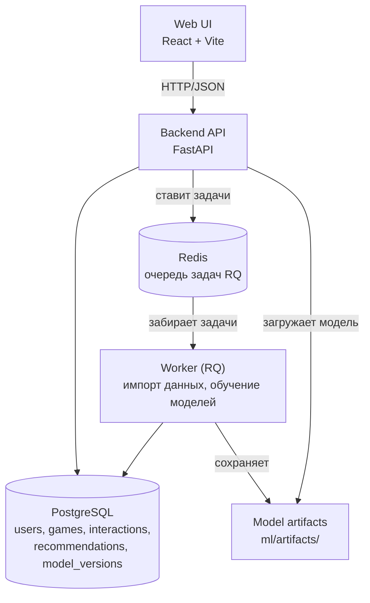

# Архитектура SideQuest

## Схема

## Компоненты

| Компонент | Технология | Ответственность |
|---|---|---|
| Web UI | React + Vite; в compose — nginx со статикой и прокси `/api` (admin через прокси закрыт) | onboarding, выдача рекомендаций, feedback-кнопки |
| Backend API | FastAPI (async) + SQLAlchemy 2 + Alembic | HTTP API, валидация, скоринг гибрида, fallback (сбой/таймаут), логи с request/user id, `/metrics` |
| migrate | one-shot контейнер | `alembic upgrade head` + импорт demo-данных при старте compose |
| БД | PostgreSQL 17 | пользователи, игры, взаимодействия, последняя выдача, версии моделей |
| Очередь | Redis + RQ | фоновые задачи: импорт данных, переобучение |
| Worker | RQ worker (только в Docker) | переобучение с promotion gate (активация только при победе над baseline), атомарная запись артефакта |
| Артефакт | `ml/artifacts/hybrid_current.json` (без pickle) | топ-20 item-item соседей + decay-популярность; версия внутри, сверяется с активной ModelVersion, перечитывается по mtime |

## Ключевые потоки

1. **Рекомендации**: UI → `GET /users/{id}/recommendations` → API загружает активную
   модель → кандидаты → фильтры (бюджет, стоп-теги) → топ-10 с объяснениями → ответ.
   При ошибке/таймауте модели — fallback: популярные игры с теми же фильтрами.
2. **Feedback**: UI → `POST /users/{id}/interactions` → запись в БД (идемпотентно,
   повторный feedback не создаёт дубликат) → немедленно влияет на следующую выдачу:
   оценённые игры исключаются из кандидатов, лайки усиливают item-item похожесть.
3. **Обучение**: `POST /admin/retrain` → задача в Redis → worker обучает на train-сплите,
   гоняет gate-замер P@10 → **активирует новую версию только если она бьёт baseline**
   (иначе версия сохраняется отклонённой, выдача не меняется) → артефакт пишется атомарно
   после коммита БД → работающий API подхватывает его по mtime без рестарта.

## Fallback-цепочка

артефакт недоступен/повреждён, версия рассинхронизирована или скоринг превысил таймаут →
популярные игры с теми же фильтрами по бюджету и стоп-тегам, фактическая модель честно
указана в ответе и в `/metrics` (распределение served_by) → на полностью пустой БД —
понятная ошибка 503 с request ID в логах.
